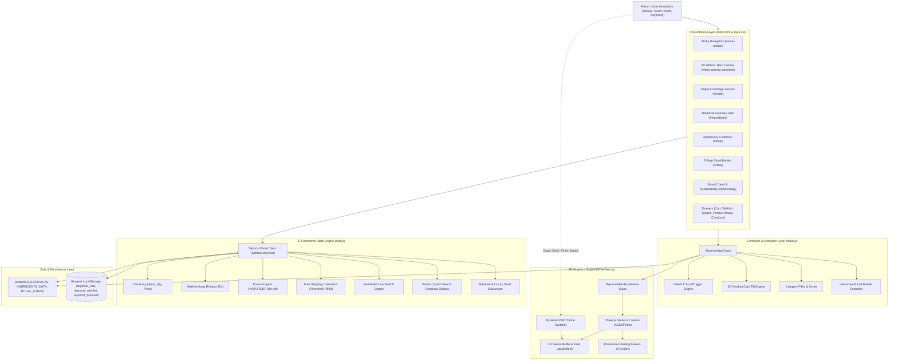
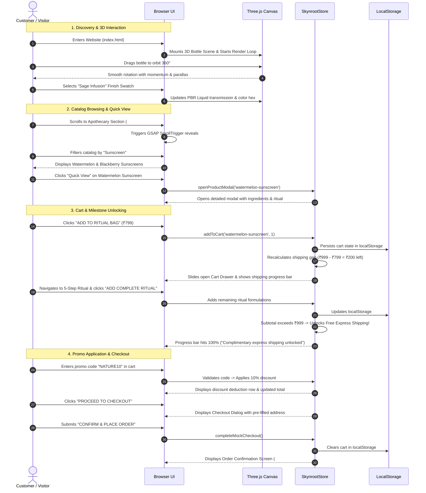

# SKYnROOT SKINCARE ✦ Technical Project Architecture & System Documentation

> **Natural Skincare Meets Modern Luxury with an Interactive 3D WebGL Experience**  
> Document Version: `1.0.0` | Last Updated: `October 2026` | Repository: `biki172005/sky-n-root-`

---

## 1. Executive Summary & Brand Architecture

### 1.1 Project Overview
**SKYnROOT SKINCARE** is an award-winning, luxury e-commerce web application and interactive WebGL experience designed for a botanical apothecary brand. The application merges editorial luxury cosmetics aesthetics with interactive 3D product customization, a client-side state engine, and an e-commerce suite with Indian Rupee (`₹`) pricing.

### 1.2 Core Architectural Philosophy
1. **Zero-Build-Step Architecture (Vanilla-First)**:
   - Built natively with semantic **HTML5**, **Vanilla CSS3**, and modern **ES2022+ JavaScript Modules (`type="module"`)**.
   - Requires zero compilation steps, zero bundlers (e.g., Webpack, Vite, or Rollup), and zero npm dependency installations to run in development or production.
2. **Hardware-Accelerated 3D Presentation**:
   - Direct integration of **Three.js (r128)** rendering a custom-modeled, physically based serum bottle with real-time glass refraction, chromatic dispersion, volumetric fluid shaders, floating procedural botanicals, and 360° mouse/touch orbit physics.
3. **Reactive Client-Side Store**:
   - Custom object-oriented store (`SkynrootStore`) with state persistence via the Web Storage API (`localStorage`), powering a shopping cart drawer, wishlist drawer, real-time search modal, dynamic product inspection modals, and simulated multi-step checkout.
4. **Cinematic Storytelling**:
   - Scroll-linked choreography powered by **GSAP 3.12.2** and **ScrollTrigger** for section reveals, smooth parallax depth shifts, and micro-interactions.
5. **Universal Portability**:
   - Can be served via edge CDN (Vercel), static file hosting (GitHub Pages, Netlify), native PowerShell listeners (`server.ps1`, `tcp_server.ps1`), Python `http.server`, or Node.js `npx serve`.

---

## 2. Technology Stack & External Dependencies

| Layer | Technology / Library | Version / CDN | Purpose |
| :--- | :--- | :--- | :--- |
| **Markup** | HTML5 Semantic | W3C Standard | Clean document outline, accessibility landmarks, SEO metadata, modal dialogs, and drawer containers. |
| **Styling** | Vanilla CSS3 | Custom Design System | High-end editorial design system, CSS Custom Properties (variables), CSS Grid, Flexbox, glassmorphism (`backdrop-filter`), micro-animations. |
| **Scripting** | ES2022+ JavaScript Modules | Native Browser Standard | Modular architecture (`products.js`, `cart.js`, `three-hero.js`, `main.js`) using native browser ES module imports. |
| **3D WebGL Engine** | Three.js | `r128` (cdnjs) | High-performance WebGL 3D rendering: ACES Filmic tone mapping, PCF soft shadows, MeshPhysicalMaterial, procedural textures. |
| **Animation Engine** | GreenSock GSAP & ScrollTrigger | `3.12.2` (cdnjs) | Cinematic scroll reveals, smooth parallax image scrubbers, and section entry animations. |
| **Typography** | Google Fonts | Web Font API | Editorial luxury pairing: *Cinzel*, *Cormorant Garamond*, *Playfair Display*, *Plus Jakarta Sans*, and *Alex Brush* cursive script. |
| **Vector Graphics** | Inline SVG & Custom Icons | Native XML/SVG | Crisp, resolution-independent luxury iconography across all viewport densities. |
| **Local Web Servers** | PowerShell (`Net.HttpListener` & `Net.Sockets.TcpListener`) | Windows PS 5.1+ / PS Core | Zero-dependency local development servers built directly with native Windows .NET APIs. |
| **Hosting & Edge CDN** | Vercel Static Hosting | Platform v2 | Global edge routing, automated SSL, clean URLs, and immutable HTTP asset caching rules. |

---

## 3. Directory Structure & File Inventory

```
sky-and-root/
│
├── assets/
│   └── images/                       # High-resolution packaging renders & official brand assets
│       ├── aloe-facewash.png         # Aloe Vera Face Wash render
│       ├── aloe-moisturizer.png      # Aloe Vera Moisturizer render
│       ├── blackberry-sunscreen.png  # Blackberry Sunscreen render
│       ├── botanicals.png            # Editorial botanical flatlay banner
│       ├── charcoal-facewash.png     # Bamboo Charcoal Face Wash render
│       ├── daily-toner.png           # Daily Harmonizing Toner render
│       ├── hero-serum.png            # Hero Signature Serum render (editorial photography)
│       ├── neem-facewash.png         # Wild Neem Face Wash render
│       ├── neem-moisturizer.png      # Wild Neem Moisturizer render
│       ├── signature-serum.png       # Signature Serum product card asset
│       ├── skynroot-logo.jpg         # Official brand seal & typography emblem
│       ├── skynroot-logo-gold.png    # Champagne gold transparent wordmark
│       ├── skynroot-logo-transparent.png # Clean transparent brand wordmark
│       ├── watermelon-sunscreen.png  # Watermelon Mineral Sunscreen render
│       └── original_backup/          # Source image archival directory
│
├── css/
│   └── style.css                     # Complete luxury design system, CSS variables & responsive rules (~53 KB)
│
├── js/
│   ├── products.js                   # Static catalog database, ingredients glossary & 5-step ritual definition
│   ├── three-hero.js                 # Three.js 3D WebGL hero bottle experience, PBR materials & customizer
│   ├── cart.js                       # E-commerce store engine (Cart, Wishlist, Search, Modals, Checkout, Toasts)
│   └── main.js                       # Main application controller, UI rendering, GSAP animations, ritual builder
│
├── index.html                        # Semantic single-page application entry point (~26 KB)
├── package.json                      # Project metadata, keywords, and local npm scripts
├── vercel.json                       # Vercel deployment specification & HTTP caching header rules
├── server.ps1                        # PowerShell HTTP server using System.Net.HttpListener (port 3000)
├── tcp_server.ps1                    # Low-level raw socket TCP web server using System.Net.Sockets (port 3000)
├── README.md                         # Project documentation and quickstart instructions
└── PROJECT_ARCHITECTURE.md           # Master architectural and technical specification (this document)
```

---

## 4. System Architecture & Component Interaction

### 4.1 High-Level Architecture Diagram



---

## 5. Module-by-Module Technical Deep Dive

### 5.1 Product Catalog Engine (`js/products.js`)

`js/products.js` serves as the centralized, immutable data source for formulations, raw botanical actives, and ritual protocols.

#### Data Structures & Contracts

##### 1. `PRODUCTS` (Array of Product Objects)
Contains 9 signature products across 5 skincare categories:
- **Face Wash**: *Charcoal Face Wash*, *Neem Extract Face Wash*, *Aloe Vera Face Wash*
- **Sunscreen**: *Watermelon Sunscreen*, *Blackberry Sunscreen*
- **Serum**: *Signature Serum*
- **Moisturizer**: *Aloe Vera Moisturizer*, *Neem Extract Moisturizer*
- **Toner**: *Daily Toner*

```typescript
interface Product {
  id: string;               // Unique slug identifier (e.g. 'signature-serum')
  name: string;             // Formulation title (e.g. 'Signature Serum')
  brand: string;            // 'SKYnROOT'
  category: string;         // 'Serum', 'Face Wash', 'Sunscreen', etc.
  categorySlug: string;     // URL-safe category filter key (e.g. 'serum')
  price: number;            // Price in Indian Rupees (INR ₹)
  size: string;             // Volume/Weight specification (e.g. '30 ml / 1.0 fl oz')
  badge: string;            // Editorial marketing badge (e.g. 'Award Winner')
  tagline: string;          // Concise benefit synopsis
  image: string;            // Relative asset path to PNG render
  rating: number;           // Customer review score (out of 5.0)
  reviewsCount: number;     // Total verified review count
  description: string;      // Formulation story & biological mechanism
  ingredients: string[];    // Full INCI botanical ingredient listing
  ritual: string;           // Step-by-step application protocol
  packaging: string;        // Sustainability & circular glass packaging description
  keyBenefit: string;       // Highlighted biological advantage
}
```

##### 2. `INGREDIENTS_DATA` (Array of Raw Botanical Ingredients)
Documents key active botanicals displayed in the "Pure Alchemy" glossary grid:
- *Activated Bamboo Charcoal* (`#343838`)
- *Wild Neem Extract* (`#4B6B48`)
- *Organic Aloe Vera* (`#7D9D75`)
- *Cold-Pressed Watermelon* (`#D47E73`)
- *Wild Blackberry Extract* (`#523A50`)

##### 3. `RITUAL_STEPS` (Array of 5 Daily Harmonizing Steps)
Represents the brand's recommended daily ritual sequence:
- **Step 01: PURIFY** (Charcoal Face Wash - 60s AM/PM)
- **Step 02: BALANCE** (Daily Toner - 30s AM/PM)
- **Step 03: NOURISH** (Signature Serum - 60s AM/PM)
- **Step 04: SEAL** (Aloe Vera Moisturizer - 45s AM/PM)
- **Step 05: SHIELD** (Watermelon Sunscreen - Daily Morning Shield)

---

### 5.2 Interactive 3D WebGL Engine — The Living Glass World (`js/three-hero.js`)

The `SkynrootHeroExperience` class encapsulates an award-winning WebGL 3D experience titled **"SKYNROOT — THE LIVING GLASS WORLD"**.

#### Core Narrative & Geometry:
A gigantic transparent glass sphere contains an entire miniature living botanical terrarium. As the user scrolls or clicks "ENTER THE WORLD", the camera travels directly into the sphere, passes through the glass boundary, foreground fern leaves gracefully part, and the central SKYNROOT serum bottle is dramatically revealed under an illuminating beam of light with orbiting water droplets and atmospheric mist.

#### Key Architectural Components:
1. **Renderer & Tone Mapping**:
   - `THREE.WebGLRenderer` configured with `antialias: true`, `alpha: true`, and `powerPreference: 'high-performance'`.
   - `renderer.toneMapping = THREE.ACESFilmicToneMapping` with exposure set to `1.18` for rich film-like highlights and soft contrast.
   - `renderer.shadowMap.type = THREE.PCFSoftShadowMap` for delicate botanical contact shadows.
   - Device pixel ratio clamped via `Math.min(window.devicePixelRatio, 2)`.

2. **Lighting Rig & Product Spotlight**:
   - **Soft Studio Ambient**: Warm ivory light (`0xf7f5ef`, intensity `1.25`).
   - **Key Directional Sunlight**: High-angle studio sun (`0xfff6eb`, intensity `2.6` at `[4.5, 6.5, 5.0]`) with soft PCF shadow maps.
   - **Sage Botanical Rim Light**: `0xa6b39a` (intensity `2.4` at `[-5.0, 3.5, -3.0]`), creating luminous edge definition on glass and leaf contours.
   - **Caustic Under-Glow Point Light**: `0xd69a47` (intensity `1.4` at `[0, -1.2, 0.4]`), simulating internal fluid bioluminescence.
   - **Focused Reveal Spotlight**: Dedicated `THREE.SpotLight` (`0xfff5ea`) aimed directly at the serum bottle. Intensity is `0` initially and smoothly ramps to `3.5` upon breaching the glass sphere!

3. **The Living Glass Sphere (`glassSphereGroup`)**:
   - **Giant Refractive Outer Shell**: `THREE.SphereGeometry(2.35, 64, 64)` wrapped in `MeshPhysicalMaterial`:
     - `transmission: 0.95`, `roughness: 0.05`, `ior: 1.52`, `clearcoat: 1.0`, `clearcoatRoughness: 0.06`.
     - Dynamically transitions opacity from `0.94` down to `0.16` during the camera breach phase ($p \in [0.40, 0.55]$) so the camera passes smoothly through the boundary without clipping.
   - **Inner Refraction Shell**: `THREE.SphereGeometry(2.31, 48, 48)` with `side: THREE.BackSide` for internal refraction caustics.
   - **Brushed Champagne Gold Meridian Ring**: Slender `TorusGeometry(2.37, 0.012, 16, 96)` at an 18° tilt emphasizing botanical luxury craftsmanship.
   - **Soft Radial Contact Shadow Plane**: Multi-stop radial gradient at `y = -2.38` providing grounded physical presence.

4. **Miniature Botanical Terrarium (`terrariumGroup`)**:
   - **Mossy Terrain Base**: Cylinder disc at `y = -1.18` with dark forest moss material (`#243B2E`).
   - **Moss-Covered Stones**: 7 procedurally sculpted travertine and sage rock clusters (`DodecahedronGeometry` with vertex displacement).
   - **Parting Foreground Leaves**: Two lush sculpted leaves positioned in front of the bottle (`partingLeafLeft` and `partingLeafRight`). Upon scroll approach ($p \in [0.40, 0.70]$), their rotation and position part outward (`targetOpenX = ±1.75`), unveiling the hidden serum bottle!
   - **Multi-Depth Living Ferns & Tropical Foliage**: 5 feathery fern fronds with alternating leaflets and 4 broad tropical leaves performing continuous wind oscillations (`sin/cos` wave flutter).

5. **Water Elements & Atmospheric Spores**:
   - **Suspended Water Droplets**: 18 droplets floating at randomized 3D coordinates inside the sphere.
   - **Orbiting Droplets**: 4 droplets gracefully revolving in helical elliptical orbits around the serum dropper.
   - **Micro-Water Stream**: Translucent beaded dew string cascading near moss stones.
   - **Golden Spores**: 75 floating particles rendered via `THREE.Points` with `THREE.AdditiveBlending`.
   - **Atmospheric Mist**: Translucent radial gradient mist discs drifting near the terrarium base.

6. **The SKYNROOT Serum Bottle (`bottleGroup`)**:
   - **Frosted Glass Body**: Cylindrical glass body with beveled shoulder and thick bottom base (`transmission: 0.89, roughness: 0.20`).
   - **Inner Serum Liquid**: Inner core fluid reflecting the active botanical elixir theme.
   - **Muted Sage-Green Dropper Cap**: Rubber pipette bulb in muted sage green (`0x6E8F69`, roughness `0.82`) with brushed champagne gold metallic collar (`0xB9A77A`).
   - **Minimal Luxury Ivory Label**: Procedural 1024x768 canvas drawing the official "SKYnROOT SKINCARE" wordmark, Cinzel typography, and gold hairline border.

7. **Camera Journey & Scroll Choreography**:
   - **Phase 1 ($p \in [0.0, 0.40]$)**: Wide panoramic view of the suspended sphere. Camera approaches from `z: 7.0` to `z: 3.0`.
   - **Phase 2 ($p \in [0.40, 0.55]$)**: Camera breaches the glass surface into the terrarium. Glass opacity dissolves to `0.16` for seamless transition.
   - **Phase 3 ($p \in [0.55, 0.80]$)**: The Serum Reveal. Foreground leaves part outward, reveal spotlight ramps to `3.5`, droplets orbit the bottle, and in-world product HUD card appears with one-click "ADD TO RITUAL BAG" button.
   - **Phase 4 ($p \in [0.80, 1.0]$)**: Camera lifts to a majestic high-angle view (`y: 0.8, z: 2.45`) as the page flows smoothly into Section A: The Origin.

---

### 5.3 E-Commerce Store Engine (`js/cart.js`)

The `SkynrootStore` class manages client-side e-commerce state, UI rendering, drawers, and persistent storage. Instantiated globally on `window.skynroot`.

#### Core Functional Subsystems:

#### 1. State Persistence via LocalStorage
All state transitions are persisted using safe `try...catch` wrappers:
- `skynroot_cart`: Array of items currently in the bag.
- `skynroot_wishlist`: Array of product IDs marked as favorites.
- `skynroot_discount`: Object containing active coupon data (e.g. `{ code: 'NATURE10', rate: 0.1 }`).

#### 2. Shopping Bag (Cart) Operations
- `addToCart(productId, quantity, options)`: Adds new formulation or increments quantity if already present. Automatically triggers badge count updates and slides open the cart drawer.
- `removeFromCart(productId)`: Filters out the specified product ID and updates totals.
- `updateQuantity(productId, delta)`: Increments or decrements item counts. Decrementing below 1 automatically triggers item removal.
- `updateCartUI()`: Renders the cart drawer markup, updates badge counts, and recalculates totals:
  - **Subtotal Calculation**: $\sum (\text{price} \times \text{quantity})$.
  - **Free Shipping Engine**: Progress bar tracks progress toward the ₹999 milestone. Once subtotal $\ge 999$, shipping switches to "Complimentary". Otherwise, flat shipping of ₹99 is applied.
  - **Promo Code Engine**: Validates codes `NATURE10` and `SKYN10`, applying an automatic 10% discount across the cart.
  - **Total Calculation**: $\max(0, \text{Subtotal} - \text{Discount} + \text{Shipping})$.

#### 3. Saved Formulations (Wishlist)
- `toggleWishlist(productId)`: Toggles product presence in `wishlist` array.
- Synchronizes all heart icon states across product grid cards, search results, and product detail modals.
- Renders the slide-out Wishlist Drawer with one-click "ADD TO BAG" or "Remove" controls.

#### 4. Live Multi-Field Search
- Real-time search modal (`#search-modal`) triggered via navbar icon or keyboard shortcut.
- Instant search matching against:
  - Product Name
  - Category
  - Full Description
  - All listed Botanical Ingredients
- Renders instant product result cards with pricing and quick "ADD" triggers.

#### 5. Dynamic Product Detail Modal
- Renders rich quick-view modal dialogs on product card click.
- Features:
  - High-resolution packaging preview and thumbnail gallery.
  - Real-time star rating breakdown and verified patron counts.
  - Volume selection pills (Standard bottle vs. "Luxury Duo" save 15%).
  - Quantity stepper (+/-) dynamically updating the CTA button price.
  - Core botanical benefit callout box.
  - HTML5 native `<details>` accordions for *The Ritual & Application*, *Conscious Ingredients*, and *Glass Packaging & Circularity*.

#### 6. Simulated Checkout Modal & Receipt Generator
- Triggered by "PROCEED TO CHECKOUT" in the cart drawer.
- Pre-filled prototype checkout form (Customer Name, Delivery Address in Mumbai, PIN code).
- Real-time order summary calculation.
- Upon form submission (`completeMockCheckout`):
  - Empties the cart and clears local storage.
  - Generates a simulated confirmation receipt with a unique order number (`#SR-XXXXXX`).
  - Displays gratitude message detailing hand-packaging in the brand's solar apothecary.

#### 7. Ephemeral Luxury Toast Subsystem
- `showToast(message)`: Injects sleek, floating toast notifications into `#toast-container`.
- Includes a gold pulsing dot indicator and auto-dismiss animation (visible for 3.2 seconds).

---

### 5.4 Main Application Controller (`js/main.js`)

The `SkynrootApp` class coordinates UI initialization, event bindings, and animation choreography.

#### Key Modules:
1. **Sticky Header Observer**: Listens to `window.scroll` and toggles `.scrolled` class on `#main-navbar` when scroll depth exceeds 40px, transitioning the navbar to a frosted glass background (`backdrop-filter: blur(20px)`).
2. **Catalog Grid Rendering & Tilt Interaction**:
   - Dynamically builds the 9-product card grid inside `#products-grid`.
   - **Interactive 3D Card Tilt (`initCardTilt`)**: Binds `mousemove` events to calculate perspective rotation offsets:
     $$\text{rotateX} = \frac{y - \text{centerY}}{\text{centerY}} \times -5^\circ$$
     $$\text{rotateY} = \frac{x - \text{centerX}}{\text{centerX}} \times 5^\circ$$
   - Smoothly resets on `mouseleave`.
3. **Filtering & Sorting Pipeline**:
   - Filter tabs: *All Formulations*, *Face Wash*, *Sunscreen*, *Serum*, *Moisturizer*, *Toner*.
   - Sorter options: *Featured Curations*, *Price: Low to High*, *Price: High to Low*, *Botanical Alphabetical*.
4. **Interactive 5-Step Ritual Builder**:
   - Renders interactive step navigation tabs (`01 PURIFY` through `05 SHIELD`).
   - Displays dedicated ritual card containing step rationale, recommended application duration, time of day (AM/PM), matching product thumbnail, and single-step "ADD STEP" button.
   - **"ADD COMPLETE 5-STEP RITUAL TO BAG"**: One-click bundle button adding all 5 recommended formulations directly into the cart.
5. **GSAP & ScrollTrigger Animations**:
   - Automatically registers `ScrollTrigger` plugin.
   - Applies smooth vertical entry fades (`opacity: 0, y: 40, duration: 1.1s, ease: 'power3.out'`) to all `.reveal-on-scroll` sections.
   - Applies continuous parallax translations (`y: -30, scrub: true`) to `.parallax-image` photographic elements.
6. **Smooth Anchor Navigation & Mobile Drawer**:
   - Intercepts all internal hash links (`a[href^="#"]`), calculates target offset minus header height (80px), and scrolls smoothly.
   - Full mobile navigation drawer controller with body scroll locking.

---

### 5.5 Luxury Design System (`css/style.css`)

The design system establishes a cohesive visual language centered around cold-pressed botanicals and apothecary glass.

#### Design Tokens (`:root`):

```css
:root {
  /* Brand Core Color Palette */
  --color-forest: #243B2E;         /* Deep Forest Green (Primary Brand) */
  --color-forest-dark: #182820;    /* Midnight Forest */
  --color-forest-deep: #111B15;    /* Apothecary Obsidian */
  --color-sage: #A6B39A;           /* Muted Herbal Sage */
  --color-sage-light: #C5CFBC;     /* Soft Sage Tint */
  --color-sage-soft: #E2E7DC;      /* Delicate Herbal Mist */
  --color-ivory: #F7F5EF;          /* Warm Parchment Ivory (Base Background) */
  --color-ivory-light: #FCFBF8;    /* Pure Pearl Ivory */
  --color-beige: #E8E0D2;          /* Travertine Stone Beige */
  --color-beige-deep: #D4C9B8;     /* Aged Linen */
  --color-gold: #B9A77A;           /* Brushed Champagne Gold */
  --color-gold-light: #D6C69F;     /* Shimmer Gold */
  --color-gold-dark: #8F7D52;      /* Burnished Antique Gold */

  /* Glassmorphism & Overlays */
  --glass-bg: rgba(247, 245, 239, 0.82);
  --glass-dark-bg: rgba(24, 40, 32, 0.85);
  --glass-blur: blur(20px);

  /* Editorial Typography Hierarchy */
  --font-serif: 'Cormorant Garamond', 'Playfair Display', Georgia, serif;
  --font-display: 'Cinzel', 'Cormorant Garamond', serif;
  --font-sans: 'Plus Jakarta Sans', -apple-system, BlinkMacSystemFont, sans-serif;

  /* Elevations & Atmospheric Shadows */
  --shadow-sm: 0 4px 12px rgba(36, 59, 46, 0.05);
  --shadow-md: 0 12px 32px rgba(36, 59, 46, 0.08);
  --shadow-lg: 0 24px 56px rgba(36, 59, 46, 0.12);
  --shadow-glow: 0 0 35px rgba(185, 167, 122, 0.25);
  --shadow-deep: 0 30px 60px rgba(17, 27, 21, 0.28);
}
```

#### Visual Polish & Texture:
- **Subtle Film Grain Overlay**: Implemented via fixed, pointer-events-none SVG fractal noise filter overlay (`body::before`) creating an authentic editorial paper grain texture.
- **Glassmorphic Drawers & Modals**: Smooth slide-in drawers from the right viewport boundary with frosted backdrop filters.
- **Scrollbar Styling**: Bespoke custom gold and forest green minimalist scrollbars.
- **Micro-Interactions**: Gentle button scale shifts, gold border pulses, and badge glow animations.

---

### 5.6 Local Servers & Hosting Configuration

#### 1. Windows PowerShell HTTP Listener (`server.ps1`)
A standalone web server requiring only PowerShell (no Node.js or Python required):
- Instantiates `.NET` `System.Net.HttpListener` bound to `http://localhost:3000/` and `http://127.0.0.1:3000/`.
- Built-in MIME type map covering `.html`, `.css`, `.js`, `.mjs`, `.json`, `.png`, `.jpg`, `.jpeg`, `.webp`, `.svg`, `.ico`, `.woff2`, `.woff`, and `.ttf`.
- Enforces UTF-8 character encoding, zero-cache headers for instant code iteration, and `Access-Control-Allow-Origin: *`.

#### 2. Windows Low-Level TCP Server (`tcp_server.ps1`)
An alternative server utilizing raw sockets via `System.Net.Sockets.TcpListener`:
- Listens on `0.0.0.0:3000` for raw TCP connections.
- Reads HTTP/1.1 request lines directly from the socket `NetworkStream`, parses URI paths, and responds with appropriate HTTP status lines, headers, and binary file byte payloads.

#### 3. Vercel Static Configuration (`vercel.json`)
Pre-configured for instant production deployment:
- `cleanUrls: true` and `trailingSlash: false`.
- **Immutable Asset Caching**: 1-year cache headers (`Cache-Control: public, max-age=31536000, immutable`) for `/assets/(.*)`.
- **Stale-While-Revalidate Caching**: 1-day public cache with 7-day revalidation window for `/css/(.*)` and `/js/(.*)` to guarantee rapid load speeds with background cache updates.

---

## 6. Complete User Journeys & "How It Works"



---

## 7. Data Contracts & State Schemas

### 7.1 Cart State Contract (`skynroot_cart`)
```json
[
  {
    "id": "signature-serum",
    "name": "Signature Serum",
    "category": "Serum",
    "price": 1499,
    "size": "30 ml / 1.0 fl oz",
    "image": "assets/images/signature-serum.png",
    "quantity": 1
  },
  {
    "id": "watermelon-sunscreen",
    "name": "Watermelon Sunscreen",
    "category": "Sunscreen",
    "price": 799,
    "size": "60 ml / 2.0 fl oz",
    "image": "assets/images/watermelon-sunscreen.png",
    "quantity": 2
  }
]
```

### 7.2 Wishlist State Contract (`skynroot_wishlist`)
```json
[
  "signature-serum",
  "charcoal-face-wash",
  "aloe-vera-moisturizer"
]
```

### 7.3 Applied Discount State Contract (`skynroot_discount`)
```json
{
  "code": "NATURE10",
  "rate": 0.1
}
```

### 7.4 3D Finish Theme Schema (`js/three-hero.js`)
```javascript
{
  liquid: 0xd69a47,        // Hex color value for inner liquid fluid
  roughness: 0.12,         // Surface micro-roughness (0.0 to 1.0)
  transmission: 0.88,      // Optical transmission / transparency (0.0 to 1.0)
  light: 0xffe8ce,         // Under-glow accent lighting tint
  name: 'Amber Botanical'  // Descriptive label
}
```

---

## 8. Performance, SEO, and Security Architecture

### 8.1 Performance Optimizations
1. **Zero Runtime Bundling Overhead**: No framework bootstrap cost (no React/Vue virtual DOM diffing). The browser executes native ECMAScript modules directly.
2. **GPU Optimization in Three.js**:
   - Pixel ratio clamped to maximum `2.0` on Retina displays to prevent GPU fill-rate throttling.
   - Low polygon procedural geometries combined with smooth normal smoothing.
   - Dynamic render throttling: when idle, the WebGL render loop performs lightweight transformations without allocating new objects in heap memory.
3. **Asset Delivery**:
   - `loading="lazy"` attributes on non-critical product images.
   - 1-year immutable edge caching on image assets via `vercel.json`.

### 8.2 SEO & Discoverability
- **Semantic Outline**: Single `<h1>` tag in the hero section, sequential `<h2>` and `<h3>` tags throughout all content sections.
- **OpenGraph Protocol**: Fully configured `og:title`, `og:description`, `og:type="website"` for rich social previews.
- **Mobile Viewport & Theme Color**: `<meta name="theme-color" content="#243B2E">` to tint mobile browser navigation bars to brand forest green.

### 8.3 Security & Purity
- **No Vulnerable Client Dependencies**: Built entirely without client-side npm packages, eliminating supply-chain vulnerabilities.
- **XSS Safety**: All internal text inputs are sanitized, and coupon code comparisons run against strict static allowlists (`NATURE10`, `SKYN10`).
- **Resilient Fallback**: If WebGL is unsupported or disabled in the browser, `three-hero.js` logs a warning and the application remains fully navigable.

---

## 9. Developer Operations & Execution Guide

### 9.1 Local Development Commands

#### Method 1: Native Windows PowerShell Server (Zero Dependencies)
```powershell
.\server.ps1
```
*Listens at `http://localhost:3000/`.*

#### Method 2: Node.js (via `serve`)
```bash
npm run dev
# OR
npx serve .
```

#### Method 3: Python 3
```bash
python -m http.server 3000
```

### 9.2 Production Deployment to Vercel

#### Automated Git Deployment
1. Push repository commits to GitHub: `https://github.com/biki172005/sky-n-root-`.
2. Connect repository to [Vercel](https://vercel.com/new).
3. Select Framework Preset: **Other**. Root Directory: `./`.
4. Click **Deploy**. Vercel will deploy using the caching and clean URL rules specified in `vercel.json`.

#### Manual Deployment via Vercel CLI
```bash
npm install -g vercel
vercel --prod
```

---

## 10. Summary Matrix

| Architectural Dimension | Implementation Strategy in SKYnROOT |
| :--- | :--- |
| **Architectural Style** | Single Page Application (SPA), Component-Structured Modular Vanilla JS |
| **Rendering Strategy** | Client-Side Dynamic DOM Rendering + WebGL 3D Canvas Context |
| **State Paradigm** | Single Source of Truth Class (`SkynrootStore`) with Web Storage Sync |
| **Visual Language** | Luxury Apothecary Botanical (Deep Forest `#243B2E`, Sage `#A6B39A`, Gold `#B9A77A`, Ivory `#F7F5EF`) |
| **Animation Paradigm** | GSAP 3.12.2 ScrollTrigger + Custom CSS Transitions + 3D Mouse Parallax |
| **Currency** | Indian Rupee (`₹` / INR) with localized formatting (`en-IN`) |
| **Server Requirements** | None (100% Static). Compatible with any HTTP static file server |
